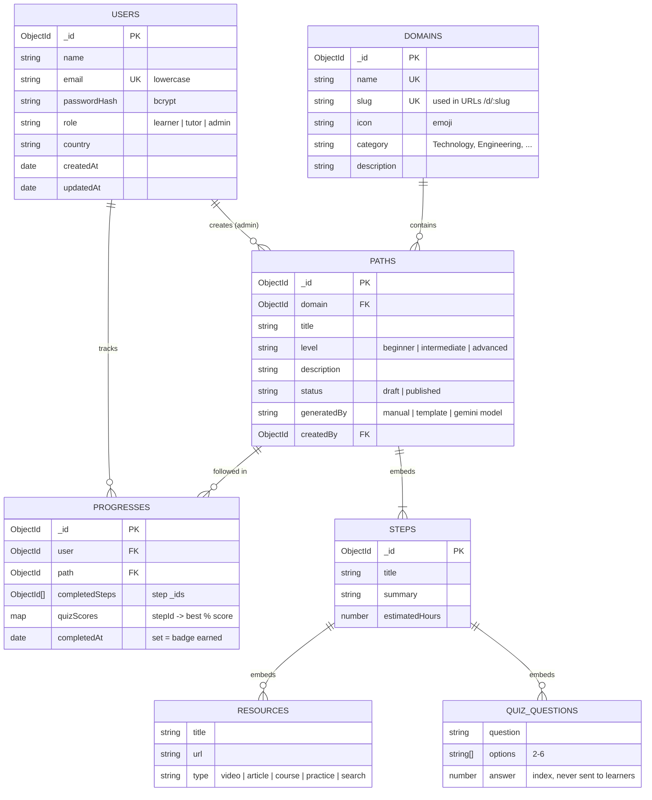

# Skillora database structure

**MongoDB Atlas** · database `skillora` · ODM: Mongoose (`server/src/models.js`)

Four collections today (stage 1). The collections planned for stages 2 and 3 are listed at the end so the design stays consistent.

## Collections

### `users`
| Field | Type | Notes |
|---|---|---|
| `name` | String, required | max 80 chars |
| `email` | String, required, **unique** | stored lowercase |
| `passwordHash` | String, required | bcrypt (10 rounds); the plain password is never stored |
| `role` | `learner` \| `tutor` \| `admin` | default `learner`; `tutor` reserved for stage 3 |
| `country` | String | optional; will drive country-based pricing in stage 3 |

### `domains`
| Field | Type | Notes |
|---|---|---|
| `name` | String, **unique** | e.g. "Mechanical Engineering" |
| `slug` | String, **unique** | URL key, e.g. `mechanical-engineering` |
| `icon` | String | emoji |
| `category` | String, indexed | one of the 7 categories, or `Other` |
| `description` | String | |

The starter catalogue (23 domains) lives in `server/src/domains.js`.

### `paths`
A learning path. **Steps, resources and quiz questions are embedded**, because they are always read together with their path and never queried on their own. That makes one read per page.

| Field | Type | Notes |
|---|---|---|
| `domain` | ObjectId → `domains` | |
| `title`, `description` | String | |
| `level` | `beginner` \| `intermediate` \| `advanced` | |
| `status` | `draft` \| `published` | learners only see `published` |
| `generatedBy` | String | `manual`, `template` or the Gemini model name |
| `createdBy` | ObjectId → `users` | admin who created it |
| `steps[]` | embedded | each has its own `_id` (referenced by progress) |
| `steps[].resources[]` | `{ title, url, type }` | AI only produces `search` links; admins replace them with real ones |
| `steps[].quiz[]` | `{ question, options[], answer }` | `answer` is stripped from learner API responses |

### `progresses`
One document per learner per path.

| Field | Type | Notes |
|---|---|---|
| `user` | ObjectId → `users` | |
| `path` | ObjectId → `paths` | |
| `completedSteps` | ObjectId[] | step `_id`s passed (quiz ≥ 60% or no quiz) |
| `quizScores` | Map stepId → Number | best score per step |
| `completedAt` | Date \| null | set when all steps are done; this is the **badge** |

## Indexes
| Collection | Index | Serves |
|---|---|---|
| users | `{ email: 1 }` unique | login, duplicate-signup check |
| domains | `{ slug: 1 }` unique, `{ name: 1 }` unique | domain page, admin create |
| domains | `{ category: 1 }` | grouping by category |
| paths | `{ domain: 1, status: 1 }` | domain page: published paths of a domain |
| paths | `{ status: 1 }` | published path counts on the home page |
| progresses | `{ user: 1, path: 1 }` unique | one progress per learner per path; step completion upsert |
| progresses | `{ user: 1, updatedAt: -1 }` | dashboard, most recent first |

Mongoose builds these indexes automatically when the server starts.

## Design rules
- **No made-up links:** AI output stores search URLs only; humans add real resources.
- **Quiz answers never leave the server** for learners; scoring happens server-side.
- **Deleting a path** also deletes its `progresses`.
- **Size:** a path with 12 steps × (4 resources + 5 questions) is about 30 KB, far below MongoDB's 16 MB document limit.

## Planned (not built yet)
| Stage | Collection | Purpose |
|---|---|---|
| 2 | `doubts` `{ path, stepId, user, text, answers[], votes }` | questions on a step |
| 2 | `resourceVotes` `{ path, stepId, url, user, vote }` | upvote or report resources |
| 3 | `tutorProfiles` `{ user, domains[], bio, portfolio, verified, rating }` | tutor applications and verification |
| 3 | `sessions` `{ tutor, learner, domain, startsAt, priceLocal, currency, status }` | paid live sessions |
| 3 | `prices` `{ country, multiplier }` | country-based (purchasing power parity) pricing |

## Moving data between databases
`npm run copy-data --prefix server` with `FROM_URI` and `TO_URI` copies domains, paths and admin users (learners and progress are not copied). It is safe to re-run.
